# 🛠️ Internship Portfolio: Networking, Systems Administration & Hardware Maintenance

> Hands-on field attachment at **Stratcom Communications and Computer Solutions Limited** (Uganda)
> Bachelor of Information Technology, Busitema University, Department of Computer Studies

| | |
|---|---|
| **Intern** | Bwire Edwine Wandera |
| **Host organisation** | Stratcom Communications and Computer Solutions Ltd |
| **Period** | June – July 2025 |
| **Focus areas** | Networking & Systems Administration · Computer Hardware Repair & Maintenance |
| **Field supervisor** | Mr. Stuart McCarthy Sebulime |
| **University supervisor** | Dr. Mutungi Fredrick |
| **Tools** | Cisco Packet Tracer · PuTTY · Cisco IOS CLI · TP-Link web UI · Soldering & hardware toolkit |

---

## 📌 TL;DR: What I actually did

Everything below was done **hands-on**, first simulated in Cisco Packet Tracer and then repeated on **physical Cisco / TP-Link equipment** over a console cable and SSH/Telnet using PuTTY.

| # | Practical task | Environment | Jump to |
|---|---|---|---|
| 1 | Built and managed a wired + wireless **LAN** | Physical + Packet Tracer | [§1](#1-network-devices-i-worked-with) |
| 2 | **Terminated** straight-through & crossover Cat6 cables, tested with a cable tester | Physical | [§2](#2-structured-cabling-cable-termination) |
| 3 | **IP addressing & subnetting** (e.g. `192.168.1.0/25` → 2 subnets × 126 hosts) | Theory + labs | [§3](#3-ip-addressing--subnetting) |
| 4 | Basic **device hardening** (hostname, console/VTY passwords, enable secret, MOTD) | Packet Tracer + physical | [§4](#4-device-configuration-with-packet-tracer--putty) |
| 5 | **Default gateway**, **static IPs** and **DHCP** configuration | Packet Tracer + physical | [§5](#5-ip-assignment-gateway-static-ip-dhcp) |
| 6 | **Static, default, RIP, OSPF, EIGRP & BGP routing** | Packet Tracer + physical | [§6](#6-routing-static-default-rip-ospf-eigrp-bgp) |
| 7 | **VLANs, trunking & Router-on-a-Stick** inter-VLAN routing | Packet Tracer + physical | [§7](#7-vlans--inter-vlan-routing) |
| 8 | **Securing devices**: port security, SSH, standard / extended / named **ACLs** | Physical + Packet Tracer | [§8](#8-securing-network-devices) |
| 9 | Configured a **TP-Link as a wireless access point** | Physical | [§9](#9-wireless-network-tp-link-access-point) |
| 10 | **VoIP**: IP phones, Cisco CME telephony-service & **dial-peering** between routers | Packet Tracer + physical | [§10](#10-voip--dial-peering) |
| 11 | **Computer hardware** teardown, fault finding & maintenance | Physical | [§11](#11-computer-hardware-maintenance) |
| 12 | **Soldering / desoldering** a capacitor on a PSU board | Physical | [§12](#12-soldering--desoldering) |
| 13 | Installed **Windows 10** on an HP laptop | Physical | [§13](#13-operating-system-installation-windows-10) |

---

## 🏢 About the Organisation

Stratcom is a privately owned IT company in Uganda (operating since **July 2014**) with a tech hub equipped with desktop PCs, a **42U server rack** with routers and switches, VoIP equipment, wireless devices and a projector. Its mission is *"to bridge a lack of hands-on skills gap among Computing and Engineering students in Uganda."*

<p align="center">
  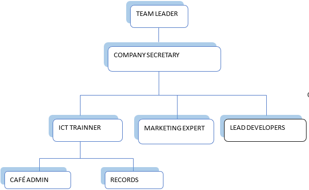<br>
  <em>Company structure: Team Leader → Company Secretary → ICT Trainer · Marketing Expert · Lead Developers → Café Admin · Records</em>
</p>

---

## 📷 Photos from the Internship Lab

<table>
  <tr>
    <td align="center">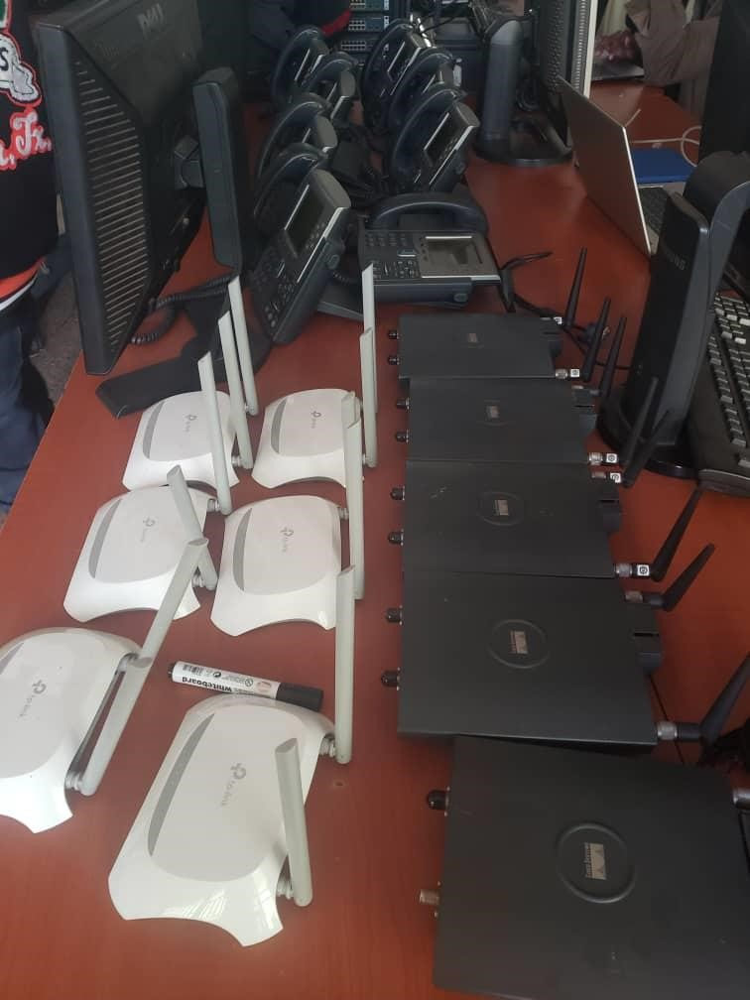<br><em>Lab bench: TP-Link routers, Cisco access points and IP phones</em></td>
    <td align="center">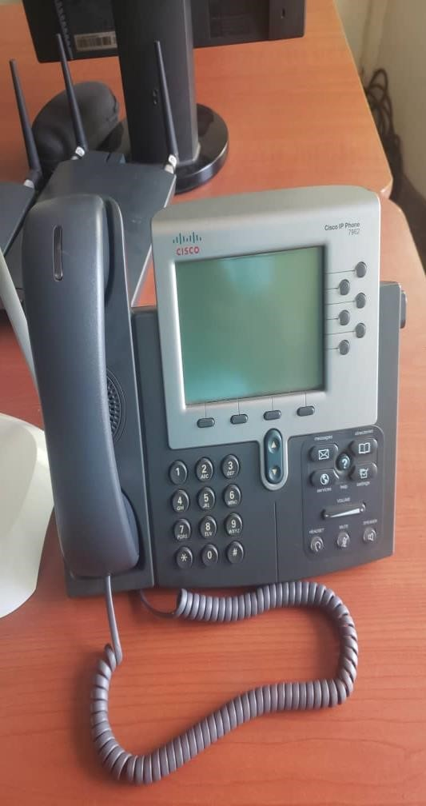<br><em>Cisco IP Phone 7962 used in the VoIP labs</em></td>
  </tr>
</table>

---

## 1. Network Devices I Worked With

<table>
  <tr>
    <td align="center">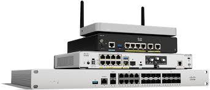<br><b>Routers</b><br>Layer 3, path selection by destination IP</td>
    <td align="center">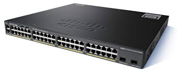<br><b>Switch</b><br>Layer 2, forms the LAN</td>
    <td align="center"><br><b>TP-Link / access point</b></td>
  </tr>
</table>

<p align="center">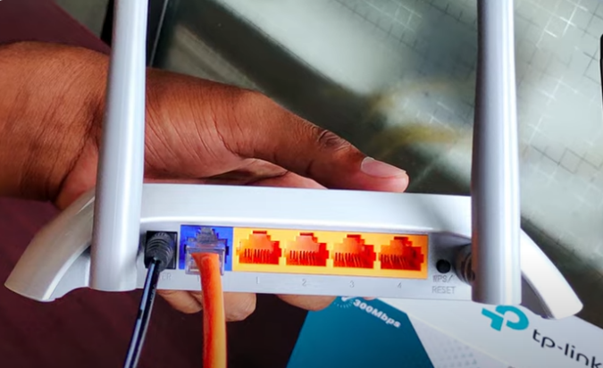</p>

**Hands-on outcome:** extended a wired network wirelessly using a TP-Link configured as an **access point**, with an SSID and password for secure client access (details in [§9](#9-wireless-network-tp-link-access-point)).

---

## 2. Structured Cabling: Cable Termination

I terminated **Cat6** Ethernet cables to the **T568A / T568B** standards and verified every cable with a tester before deployment.

| Cable type | Wiring | Used to connect |
|---|---|---|
| **Straight-through** | Same standard on both ends | Router ↔ switch, host ↔ switch/hub |
| **Crossover** | T568A on one end, T568B on the other | Router ↔ router, PC ↔ PC, switch ↔ switch |

<table>
  <tr>
    <td align="center"><br>Straight-through cable</td>
    <td align="center"><br>Crossover cable</td>
  </tr>
</table>

### Termination toolkit

<table>
  <tr>
    <td align="center"><br>1. <b>Strip</b> the jacket</td>
    <td align="center">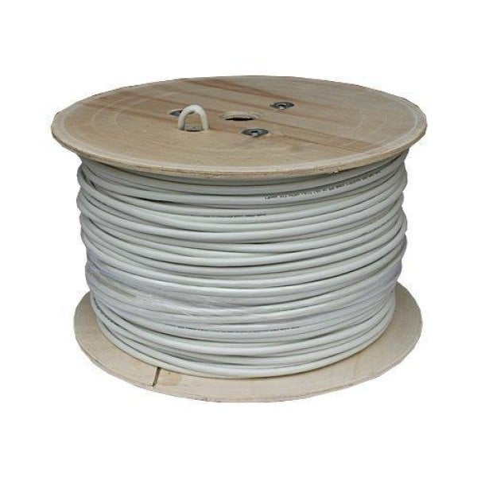<br>2. <b>Arrange</b> Cat6 pairs</td>
    <td align="center">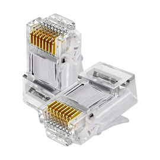<br>3. Insert into <b>RJ45</b></td>
    <td align="center"><br>4. <b>Crimp</b></td>
    <td align="center">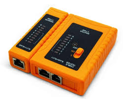<br>5. <b>Test</b> continuity</td>
  </tr>
</table>

<p align="center">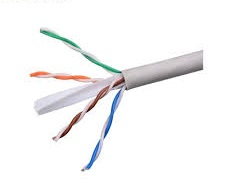</p>

---

## 3. IP Addressing & Subnetting

Worked through IPv4/IPv6 addressing, address classes (A/B/C), network vs host portions, CIDR and subnet masks.

**Worked example: `192.168.1.0/25`**

| Item | Value |
|---|---|
| Subnet mask | `255.255.255.128` |
| Total addresses per subnet | 2⁷ = **128** |
| Usable hosts per subnet | 128 − 2 = **126** |
| Subnets created | 2¹ = **2** |

| Network ID | Host range | Broadcast |
|---|---|---|
| `192.168.1.0/25` | `192.168.1.1 – 192.168.1.126` | `192.168.1.127` |
| `192.168.1.128/25` | `192.168.1.129 – 192.168.1.254` | `192.168.1.255` |

---

## 4. Device Configuration with Packet Tracer & PuTTY

I simulated every design in **Cisco Packet Tracer** first, then repeated it on real hardware via **PuTTY** (serial console first, then **SSH**, so no console cable was needed).

<table>
  <tr>
    <td align="center">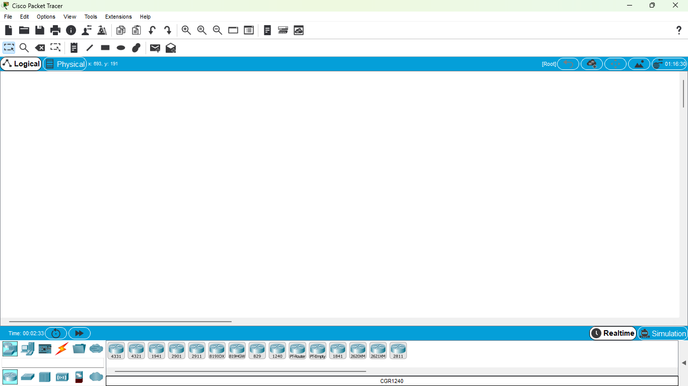<br>Cisco Packet Tracer (simulation)</td>
    <td align="center">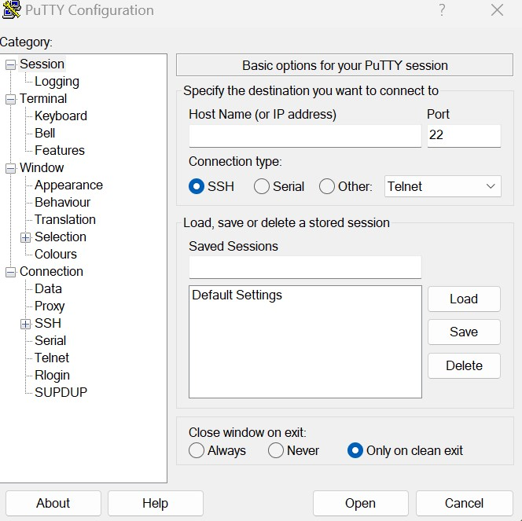<br>PuTTY (physical devices: Serial / Telnet / SSH)</td>
  </tr>
</table>

### Basic hardening of a router/switch

Hostname, `enable secret`, console password, VTY password and a login banner, all from **Global Configuration mode**.

<p align="center">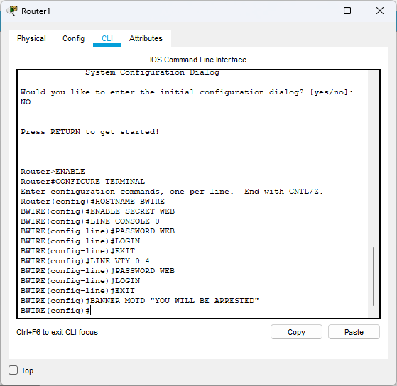</p>

📄 Commands: [`configs/01-basic-device-config.txt`](configs/01-basic-device-config.txt)

> **Note:** `enable secret` stores the password encrypted, `enable password` does not.

---

## 5. IP Assignment: Gateway, Static IP, DHCP

### Default gateway
<table>
  <tr>
    <td align="center">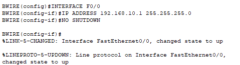<br>Configuring the gateway interface</td>
    <td align="center">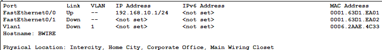<br>Verifying</td>
  </tr>
</table>

### Static IP addressing
Manually assigned IP, mask, gateway and DNS on different computers.

<p align="center">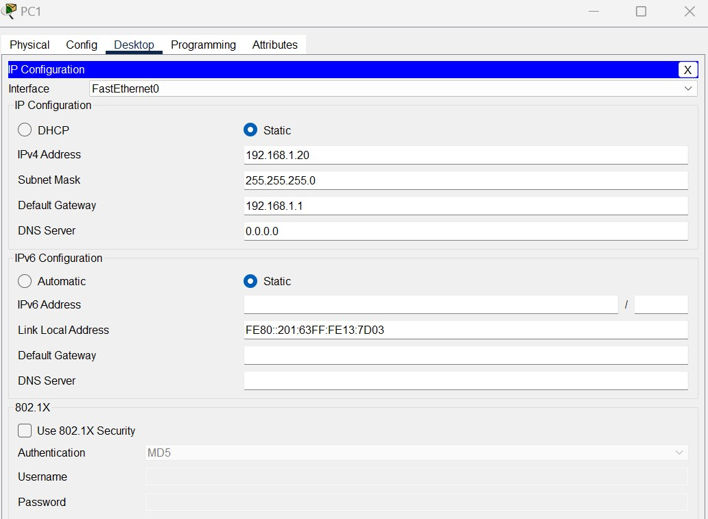</p>

### DHCP
Configured DHCP on routers so PCs received addresses automatically.

<p align="center">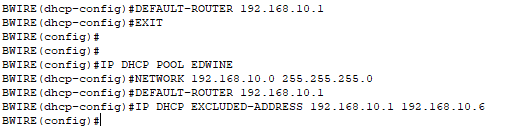</p>

<table>
  <tr>
    <td align="center">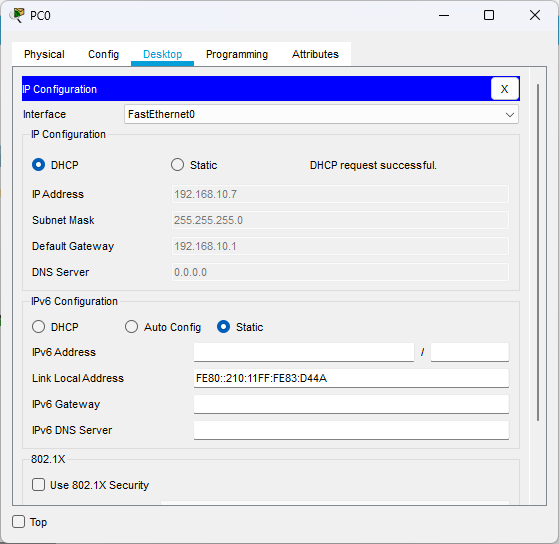<br>PC0: DHCP request successful</td>
    <td align="center">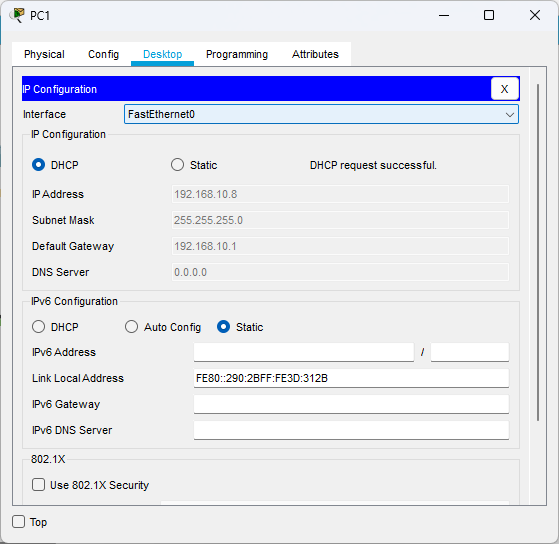<br>PC1: DHCP request successful</td>
  </tr>
</table>

📄 Commands: [`configs/02-dhcp.txt`](configs/02-dhcp.txt)

---

## 6. Routing: Static, Default, RIP, OSPF, EIGRP, BGP

I configured and **verified** each protocol with `show ip route`, checking the route code for each protocol.

| Protocol | Type | Verify: route code | Config evidence | Verification evidence |
|---|---|:---:|---|---|
| **Static** | Manual | `S` | 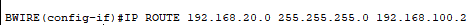 | 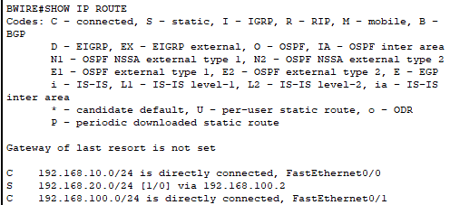 |
| **RIP v2** | Distance-vector (IGP) | `R` | 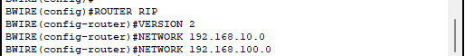 | 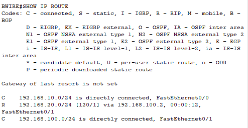 |
| **OSPF** | Link-state (IGP) | `O` | 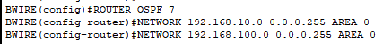 | 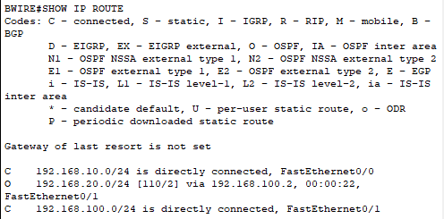 |
| **EIGRP** | Hybrid, Cisco-proprietary (IGP) | `D` | 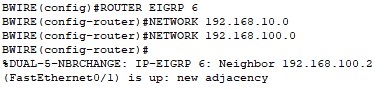 | 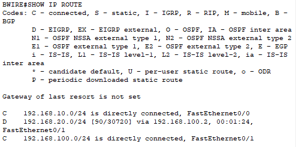 |
| **BGP** | Path-vector (EGP) | `B` | 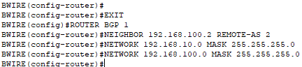 | 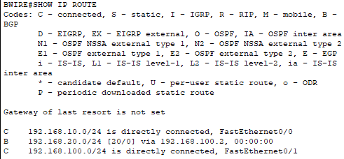 |

<details>
<summary>📎 Extra screenshots (RIP on the second router, BGP neighbour config)</summary>

<p align="center">
  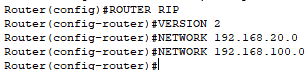
  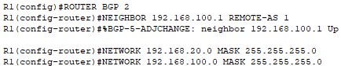
</p>
</details>

📄 Commands: [`configs/03-routing.txt`](configs/03-routing.txt)

---

## 7. VLANs & Inter-VLAN Routing

- Created VLANs on a switch (e.g. VLAN 10 `sales`) and assigned access ports individually and by range.
- Configured a **trunk** port toward the router.
- Implemented **Router-on-a-Stick (ROAS)** with `dot1Q` sub-interfaces, one per VLAN.

📄 Commands: [`configs/04-vlan-and-inter-vlan-routing.txt`](configs/04-vlan-and-inter-vlan-routing.txt)

---

## 8. Securing Network Devices

| Control | What I implemented |
|---|---|
| **Port security** | Reserved a switch port for a specific MAC address, violation mode `shutdown`, shut down unused ports |
| **SSH** (replacing Telnet) | Domain name, RSA keys, local user, `transport input ssh` on VTY lines |
| **Standard ACL** | Filter on source IP (numbered 1–99, placed near destination) |
| **Extended ACL** | Filter on source, destination, protocol/port (100–199), applied on an interface |
| **Named ACL** | `ip access-list extended STRATCOM`, editable by sequence number |

📄 Commands: [`configs/05-security-port-security-ssh-acl.txt`](configs/05-security-port-security-ssh-acl.txt)

---

## 9. Wireless Network: TP-Link Access Point

**Goal:** extend a wired network wirelessly.

1. Factory-reset the TP-Link (hold power button ~6–9 s).
2. Cabled a PC to the device and opened its admin UI at `http://tplinkuifi.net`.
3. Set the **operation mode** to *Access Point* (range extender option).
4. Entered **SSID, password, IP address, default gateway**, and enabled **Smart DHCP**.
5. Chose the **bgn mixed** wireless standard, set channel width to **auto**, and enabled **SSID broadcast**.

<table>
  <tr>
    <td align="center">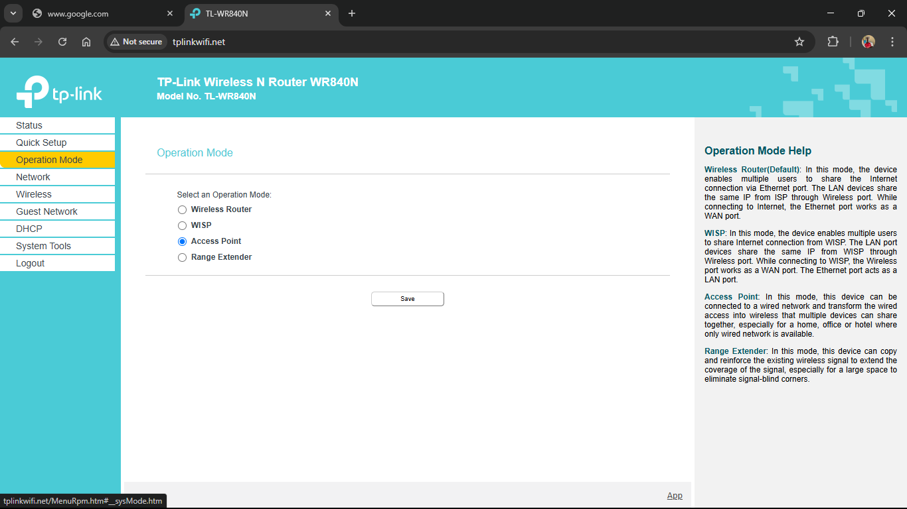<br>Selecting the operation mode</td>
    <td align="center">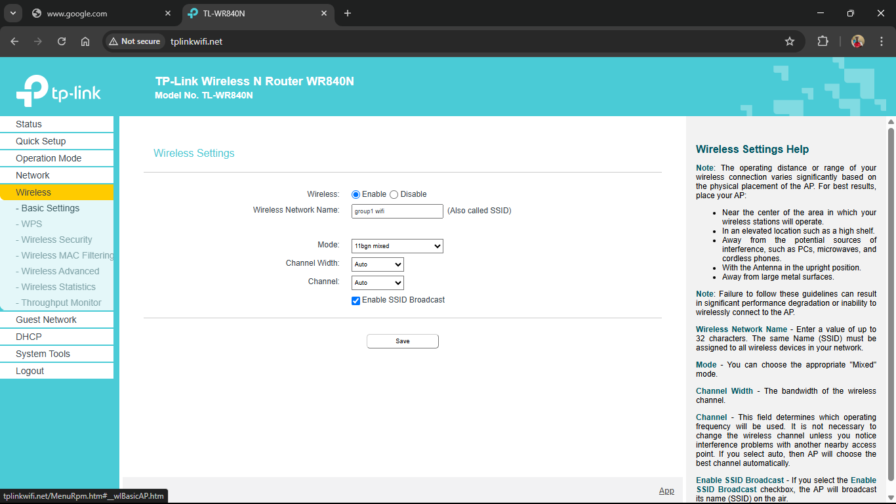<br>Wireless settings (SSID, mode, channel width)</td>
  </tr>
</table>

| Standard | Band | Max speed |
|---|---|---|
| A | 5 GHz | 54 Mbps |
| B | 2.4 GHz | 11 Mbps |
| G | 2.4 GHz | 54 Mbps |
| N | 2.4 GHz | 450 Mbps |

---

## 10. VoIP & Dial-Peering

Configured **IP phones** so they could call each other **within one network** and **across two networks**, in Packet Tracer and on physical devices (Cisco IP Phone 7962).

<table>
  <tr>
    <td align="center">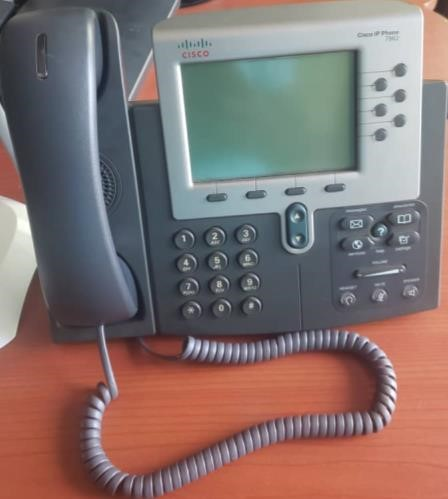<br>IP phone</td>
    <td align="center">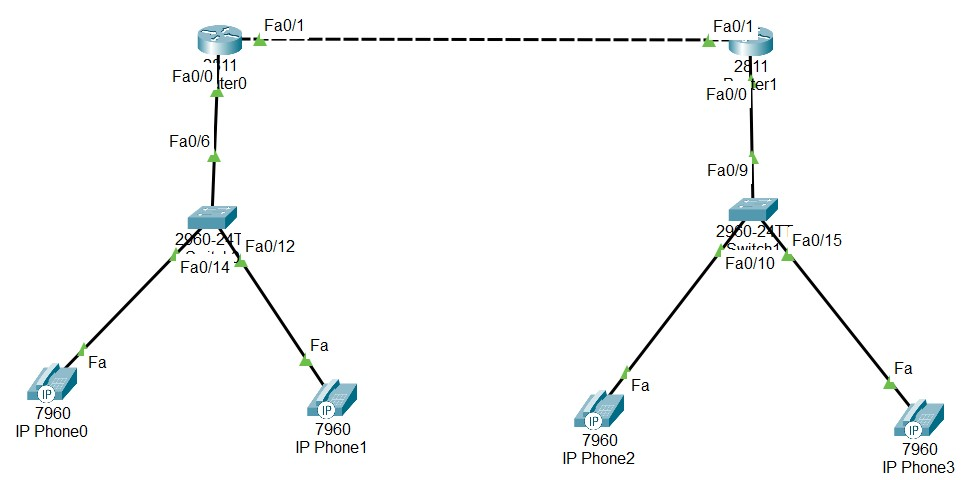<br>Dial-peering topology: two 2811 routers, two switches, four 7960 phones</td>
  </tr>
</table>

**Single-network workflow (5 steps):**
1. Router interface + DHCP pool with **Option 150** (CME/TFTP address)
2. `telephony-service` (max-dn, max-ephone, source address, auto-assign)
3. `ephone-dn` extensions (e.g. `111`)
4. Switch ports in access mode with a **voice VLAN**
5. Power on (PoE on real switches), registration, then **test calls**

**Dial-peering:** Router 1 forwards `5..` to Router 2; Router 2 forwards `2..` to Router 1 using `dial-peer voice … voip`.

📄 Commands: [`configs/06-voip-cme-and-dial-peers.txt`](configs/06-voip-cme-and-dial-peers.txt)

---

## 11. Computer Hardware Maintenance

I opened system units, identified every component, diagnosed faults, and confirmed by experiment that **a PC will not start without RAM** even when powered.

<table>
  <tr>
    <td align="center">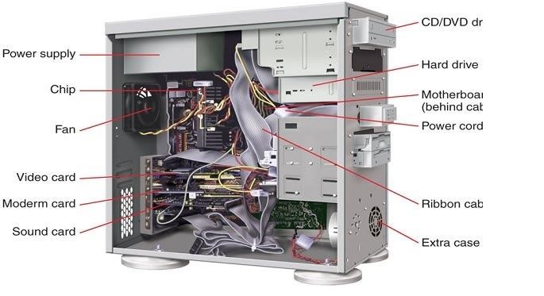<br><b>System unit</b><br>opened and inspected</td>
    <td align="center">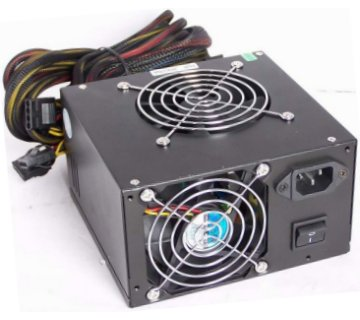<br><b>Power supply unit</b><br>AC→DC, capacitors, transformer</td>
    <td align="center">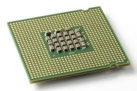<br><b>CPU</b></td>
  </tr>
  <tr>
    <td align="center">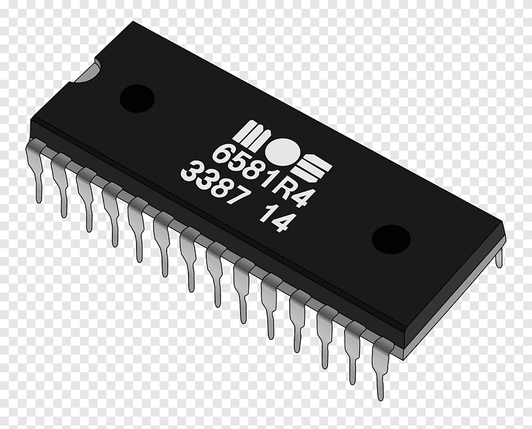<br><b>RAM / ROM chips</b></td>
    <td align="center">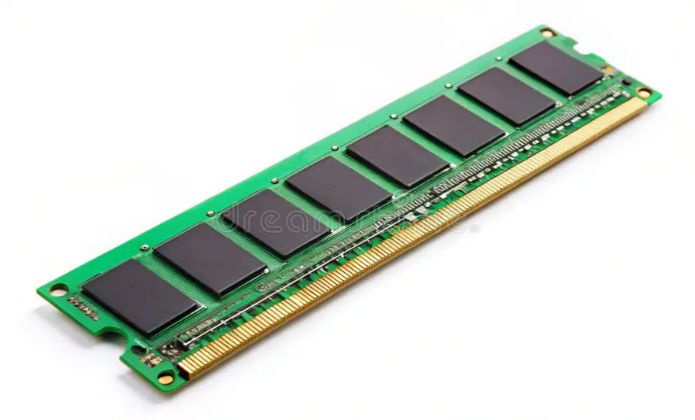<br>RAM / ROM chips (close-up)</td>
    <td align="center"><br><b>Cooling</b> (heat sink + fan, PSU fan)</td>
  </tr>
  <tr>
    <td align="center">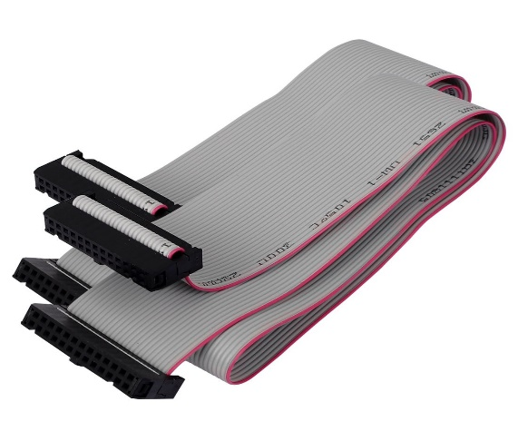<br><b>SATA</b> cable</td>
    <td align="center">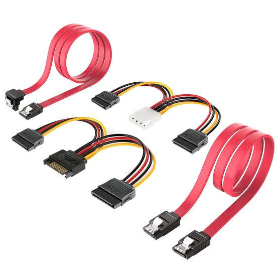<br><b>PATA</b> cable</td>
    <td></td>
  </tr>
  <tr>
    <td align="center">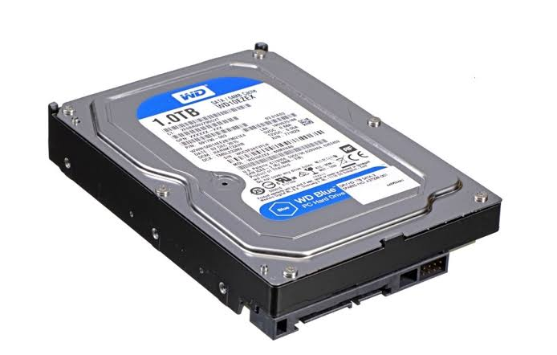<br><b>HDD</b> (magnetic platters)</td>
    <td align="center">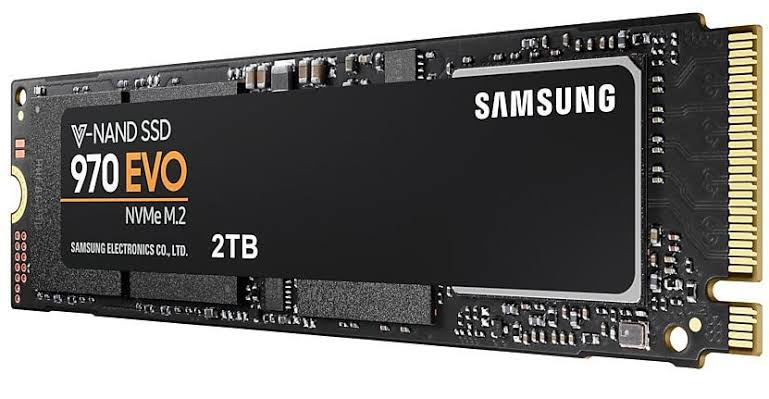<br><b>SSD</b> (NAND flash, no moving parts)</td>
    <td></td>
  </tr>
</table>

### Maintenance tools I used

| Tool | How I used it |
|---|---|
| **Electric air blower / sucker** | Dusted training-centre computers and the **switches & routers in the rack**; cleaned keyboards |
| **Manual & electric screwdrivers** | Opened laptops, power supplies and other devices |
| **Microfiber cloth** | Cleaned screens and delicate parts |
| **Endust / universal foam cleaner** | Wiped casings and keyboards, repelled dust |

<table>
  <tr>
    <td align="center"><br>Electric blower</td>
    <td align="center"><br>Electric screwdriver</td>
    <td align="center"><br>Manual screwdriver</td>
  </tr>
  <tr>
    <td align="center"><br>Microfiber cloth</td>
    <td align="center"><br>Endust</td>
    <td align="center"><br>Universal foam cleaner</td>
  </tr>
</table>

---

## 12. Soldering & Desoldering

Used a **soldering iron, solder sucker and solder wire** to **desolder and solder a capacitor** on a power-supply-unit board. Practised keeping the tip clean, returning the iron to its stand, and using a sensible length of solder wire for a neat joint.

<table>
  <tr>
    <td align="center"><br>Soldering tools</td>
    <td align="center"><br>Solder sucker / wire</td>
  </tr>
</table>

---

## 13. Operating System Installation (Windows 10)

Installed **Windows 10** on an **HP laptop**:

1. Backed up data first (installation formats the disk).
2. Inserted the **bootable flash disk** carrying the Windows installer and restarted.
3. Entered the **BIOS/boot menu** (F2 or another key, depending on manufacturer).
4. Selected the boot device, followed the installer prompts (language, keyboard).
5. Let the machine restart several times on mains power while drivers installed.
6. Reached the desktop/home screen.

<table>
  <tr>
    <td align="center">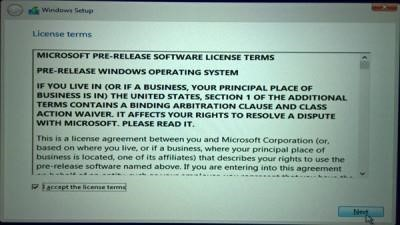<br>Windows setup</td>
    <td align="center">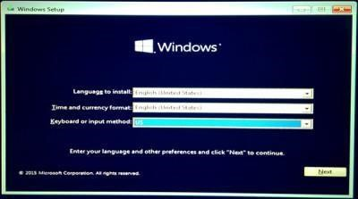<br>Language & keyboard</td>
    <td align="center">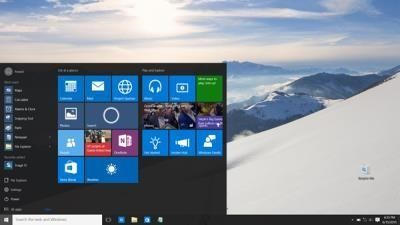<br>Home screen</td>
  </tr>
</table>

---

## 🧠 Skills Gained

| Area | Skills |
|---|---|
| **Technical** | Cisco router/switch configuration, IP addressing, subnetting, routing protocols, VLANs, ACLs, VoIP, hardware repair, OS installation |
| **Problem solving** | Diagnosing connectivity issues, isolating hardware faults by testing components methodically |
| **Communication** | Explaining technical solutions clearly to teammates and stakeholders |
| **Interpersonal** | Teamwork with fellow interns, timekeeping, workplace etiquette |

## 🧗 Challenges & How I Handled Them

| Challenge | Solution |
|---|---|
| Short training period | Prioritised the most impactful hands-on tasks |
| Congested lab / limited equipment access | Extra dedicated space was provided by Makerere University's College of Computing |
| Slow, unstable internet | Switched to more reliable network providers |
| Commuting costs | Support from my guardians |
| Older equipment & varied client setups | Self-directed study and adaptive troubleshooting |

## 💡 Recommendations (summary)

- **To Stratcom:** add newer networking devices, formal intern assessment, a mentorship programme, curriculum covering cloud, cybersecurity and network automation (e.g. Python), and an anonymous feedback channel.
- **To Busitema University:** regular supervisor visits, a longer internship, up-to-date ICT curriculum with practical electrical skills, clearer internship guidelines, and pre-internship preparatory workshops.

---

## 🎓 Completion Certificate

<p align="center">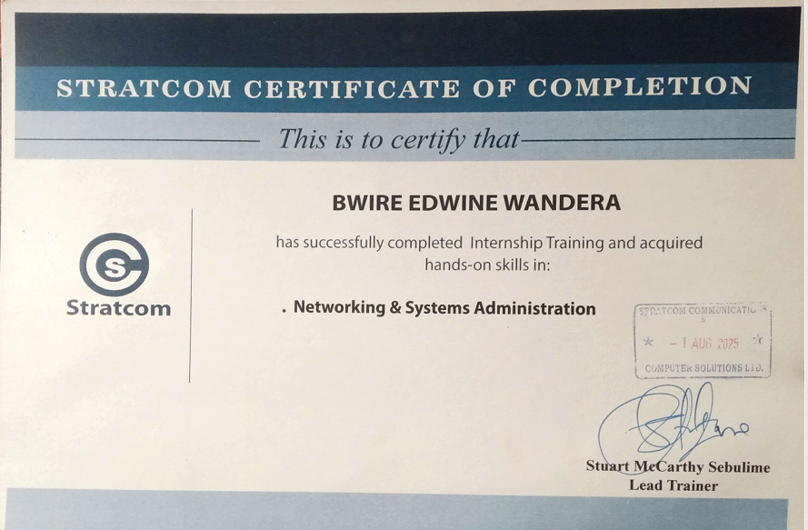</p>

---

## 📁 Repository Structure

```text
.
├── README.md                  ← this file
├── configs/                   ← Cisco IOS command references from my labs
│   ├── 01-basic-device-config.txt
│   ├── 02-dhcp.txt
│   ├── 03-routing.txt
│   ├── 04-vlan-and-inter-vlan-routing.txt
│   ├── 05-security-port-security-ssh-acl.txt
│   └── 06-voip-cme-and-dial-peers.txt
└── images/                    ← screenshots & photos, grouped by topic
    ├── appendix/  company/  devices/  cabling/  tools/
    ├── config/  routing/  wireless/  voip/
    └── hardware/  tools-hw/  os/
```

## 🏷️ Topics

`cisco` `networking` `packet-tracer` `ccna` `routing` `ospf` `eigrp` `bgp` `vlan` `acl` `voip` `tp-link` `hardware-maintenance` `internship` `uganda`

---

<sub>Source: my full internship report (June–July 2025), Department of Computer Studies, Faculty of Science and Education, Busitema University. Command files use placeholders (`x.x.x.x`, `<network-address>`) where the report did, so they are reference templates rather than device dumps.</sub>
